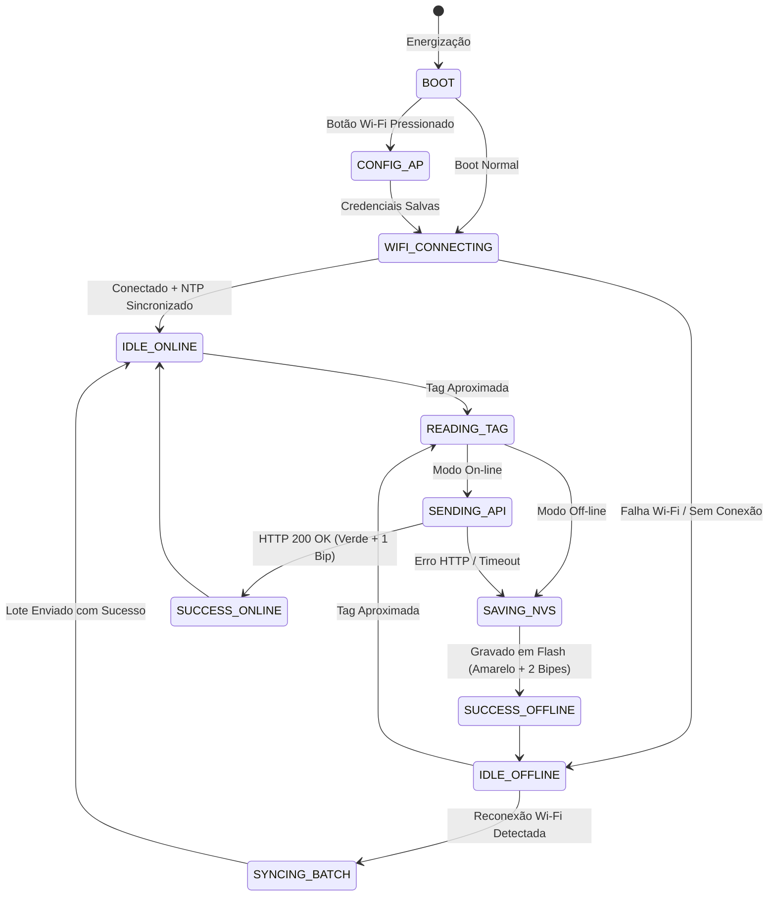

# SCP — Sistema de Chegada de Professores
> **Documentação do Projeto Multidisciplinar**
> **Disciplinas Envolvidas:** Sistemas Embarcados | Web II | Banco de Dados II

---

## Sumário
- [1. Visão Geral do Projeto](#1-visão-geral-do-projeto)
- [2. Fluxo de Funcionamento Detalhado](#2-fluxo-de-funcionamento-detalhado)
- [3. Especificação do Sistema Embarcado (IoT)](#3-especificação-do-sistema-embarcado-iot)
  - [3.1. Guia de Seleção e Recomendação de Hardware (Planejado vs. Adquirido)](#31-guia-de-seleção-e-recomendação-de-hardware-planejado-vs-adquirido)
  - [3.2. Mapeamento de Pinos e Conexões (Pinout)](#32-mapeamento-de-pinos-e-conexões-pinout)
  - [3.3. Arquitetura do Firmware & Concorrência (FreeRTOS & FSM)](#33-arquitetura-do-firmware--concorrência-freertos--fsm)
  - [3.4. Gestão de Memória Off-line e Persistência Local](#34-gestão-de-memória-off-line-e-persistência-local)
  - [3.5. Contrato de Comunicação & Payloads JSON (API REST)](#35-contrato-de-comunicação--payloads-json-api-rest)
  - [3.6. Provisionamento Wi-Fi, Sincronização NTP & RTC](#36-provisionamento-wi-fi-sincronização-ntp--rtc)
  - [3.7. Segurança, Autenticação & Atualização OTA](#37-segurança-autenticação--atualização-ota)
  - [3.8. Especificações do Gabinete Físico (Case 3D)](#38-especificações-do-gabinete-físico-case-3d)
  - [3.9. Requisitos Funcionais (RF-EMB)](#39-requisitos-funcionais-rf-emb---sistema-embarcado)
  - [3.10. Requisitos Não-Funcionais (RNF-EMB)](#310-requisitos-não-funcionais-rnf-emb---sistema-embarcado)
  - [3.11. Matriz de Testes do Sistema Embarcado](#311-matriz-de-testes-do-sistema-embarcado)
- [4. Arquitetura de Software e Persistência](#4-arquitetura-de-software-e-persistência)
  - [4.1. Backend](#41-backend)
  - [4.2. Frontend *(Escopo Removido)*](#42-frontend-escopo-removido)
  - [4.3. Banco de Dados *(Persistência Única)*](#43-banco-de-dados-persistência-única)
- [5. Próximos Passos](#5-próximos-passos)

---

## 1. Visão Geral do Projeto

O projeto consiste em um **Sistema Inteligente de Registro de Presença e Localização de Professores em Tempo Real**. 

A solução integra hardware (dispositivo IoT/Embarcado) com um **Backend REST**, um **Banco de Dados único** e um **Bot de Notificações no Telegram** para automatizar o registro de presença dos docentes nas salas de aula e laboratórios do campus, avisando automaticamente as turmas/grupos pelo Telegram.

> 🔄 **Revisão de Escopo (Versão Real de Apresentação vs. Planejamento Inicial):**  
> Durante a evolução prática do projeto, a equipe simplificou a arquitetura externa e ajustou o hardware de bancada para priorizar estabilidade e entrega funcional:
> - **Serviços Externos:** Foram removidos o **Frontend Web (Dashboard React)** e o **Banco Poliglota (SQL + NoSQL)**, adotando-se um **Banco de Dados único**. A integração de mensageria mudou de **WhatsApp** para **Telegram (Bot API)** por ter API oficial mais simples e confiável.
> - **Hardware Embarcado:** O ESP32-S3 inicial apresentou defeito físico e foi substituído pelo **ESP32 DevKit v1 (ESP-WROOM-32)**; o leitor RFID físico adquirido utiliza **I2C (`0x28`)**; e o **Display OLED 1.3"** permanece documentado como especificação de projeto (com explicação do seu funcionamento previsto), pois sofreu queima física do painel durante os testes de bancada.

```
+-------------------+       Wi-Fi       +-------------------+     Bot API     +-------------------+
| Leitor Embarcado  | ----------------> |    Backend REST   | --------------> |  Alerta Telegram  |
| (ESP32 + RFID I2C)|                   +---------+---------+                 +-------------------+
+-------------------+                             |
                                                  v
                                        +-------------------+
                                        |  Banco de Dados   |
                                        |      (Único)      |
                                        +-------------------+
```

---

## 2. Fluxo de Funcionamento Detalhado

1. **Aproximação da Tag:** O professor aproxima sua tag de identificação (contendo apenas UID único) do leitor instalado na sala/laboratório.
2. **Leitura e Filtro (Debounce):** O firmware lê o UID da tag e aplica um filtro de tempo para ignorar leituras duplicadas acidentais.
3. **Determinação de Estado (Check-in vs Check-out):**
   - O sistema valida a leitura combinando a **alternância automática** (1º bip = Entrada, 2º bip = Saída) com o **cruzamento da grade horária do docente** no backend (Terça-feira, 19:00, Disciplina Y, Laboratório Z).
4. **Sinalização Local (Especificação Completa vs. Protótipo Físico):**
   - *Na especificação completa (Wokwi/R4):* Display OLED 1.3" exibe relógio, UID e status; LEDs RGB e Buzzer sinalizam Verde + 1 Bipe curto (Sucesso), Amarelo + 2 Bipes curtos (Salvo off-line), Vermelho + 1 Bipe longo (Erro) e Azul piscando (Wi-Fi).
   - *No protótipo físico real (após queima do display OLED):* A sinalização local ocorre pelo LED onboard do ESP32 e pelos logs no Monitor Serial, além da confirmação imediata via mensagem no **Telegram**.
5. **Envio / Retransmissão de Dados:**
   - **Modo Conectado:** O embarcado envia os dados autenticados para a API do Backend.
   - **Modo Off-line (Planejado):** O registro com timestamp sincronizado via **NTP/RTC** pode ser mantido em memória local e sincronizado quando a conexão restabelecer.
6. **Validação Inteligente e Disparo do Alerta:**
   - O backend valida a janela de tempo entre o horário da leitura da tag e o término da aula.
   - Se uma sincronização off-line atrasada ocorrer após o horário limite da aula, o **alerta no Telegram é descartado**, mas o **registro histórico de presença permanece gravado** no banco de dados.

---

## 3. Especificação do Sistema Embarcado (IoT)

### 3.1. Guia de Seleção e Recomendação de Hardware (Planejado vs. Adquirido)

Para auxiliar o grupo na compra dos componentes físicos na etapa R3, cada item abaixo possui a **Opção Recomendada (A)** e a **Opção Econômica (B)** do planejamento original, seguido do comparativo com o **hardware real utilizado na versão final**:

| Componente | Opção Recomendada (A) | Opção Econômica (B) | Preço Estimado (A / B) | Justificativa Técnica & Comparativo |
| :--- | :--- | :--- | :--- | :--- |
| **Microcontrolador** | **ESP32 DevKit v1 (ESP32-WROOM-32)** | **NodeMCU ESP8266 v3** | ~R$ 38,00 / ~R$ 24,00 | **Adotado (ESP32 DevKit v1):** Processador Dual-Core (240 MHz), 520KB SRAM, Wi-Fi, Bluetooth e suporte a FreeRTOS. *(Obs.: na etapa R3 chegou-se a adquirir um ESP32-S3 DevKitC-1, mas após defeito físico constatado em bancada, o grupo substituiu pelo ESP32 DevKit v1).* |
| **Leitor RFID/NFC** | **Módulo PN532 NFC/RFID** | **Módulo RFID-RC522 (13.56 MHz)** | ~R$ 45,00 / ~R$ 16,00 | **Adotado (Módulo MFRC522 I2C Emakefun):** Opera em 13.56 MHz lendo cartões/tags Mifare 1K e NTAG215 com comunicação **I2C** (endereço `0x28`), economizando pinos em relação ao SPI. |
| **Display OLED *(Planejado)*** | **Display OLED 1.3" I2C (SH1106/SSD1306)** | **Display OLED 0.96" I2C** | ~R$ 26,00 / ~R$ 18,00 | **Documentado (Não ativo no protótipo físico):** Projetado para mostrar relógio NTP/RTC, status Wi-Fi e confirmação visual (`PONTO REGISTRADO!`, UID e hora). Durante a bancada o painel OLED sofreu dano físico (circuito de alta voltagem não acende mais, embora o chip `0x3C` ainda responda), ficando documentado o seu uso previsto. |
| **Relógio RTC *(Opcional)*** | **Módulo RTC DS3231 + Bateria CR2032** | **Módulo RTC DS1307** | ~R$ 20,00 / ~R$ 10,00 | **Substituído por NTP + Relógio Interno:** Na versão conectada via Wi-Fi, o ESP32 sincroniza a hora exata via servidor **NTP** (`pool.ntp.org`), dispensando módulo externo no protótipo atual. |
| **LED RGB e Buzzer *(Simulados)*** | **Módulo WS2812B + Buzzer Passivo** | **LED RGB 4 Pinos + Buzzer Ativo** | ~R$ 12,00 / ~R$ 6,00 | **Mantidos na especificação/simulação (Wokwi/R4):** No protótipo físico enxuto, o retorno acontece no Monitor Serial, LED onboard da placa e mensagem imediata no **Telegram**. |
| **Fonte de Energia** | **Cabo USB-C / Fonte 5V 2A** | **Fonte Genérica 5V 1A USB** | ~R$ 22,00 / ~R$ 12,00 | **Adotado:** Alimentação USB estável (5V) garantindo operação sem *Brownout Reset*. |

---

### 3.2. Mapeamento de Pinos e Conexões (Pinout)

#### A) Pinout Físico Real Utilizado (Protótipo Final: ESP32 DevKit v1 + RFID I2C)
Ligação direta ponto a ponto (com cabos Fêmea-Fêmea, evitando folgas de protoboard):

| Periférico | Pino no Componente | Pino no ESP32 DevKit v1 | Função / Protocolo |
| :--- | :--- | :--- | :--- |
| **RFID MFRC522 (I2C)** | `5V` | **`VIN`** *(topo direito)* | Alimentação 5V da USB |
| | `G` | **`GND`** *(topo direito)* | Terra |
| | `SDA` | **`GPIO 27` (`D27`)** | I2C Data (`Wire1` / endereço `0x28`) |
| | `SCL` | **`GPIO 26` (`D26`)** | I2C Clock (`Wire1` / endereço `0x28`) |
| **Display OLED 1.3" *(Planejado)*** | `VCC` / `GND` | `3V3` / `GND` *(topo esquerdo)* | Alimentação 3.3V *(documentado)* |
| | `SDA` / `SCL` | `GPIO 21` (`D21`) / `GPIO 22` (`D22`) | I2C padrão (`Wire` / endereço `0x3C`) |

#### B) Pinout de Referência da Especificação Completa / Simulação Wokwi (Etapa R4)
Para fins de comparação com a montagem virtual no Wokwi ([`wokwi_project/diagram.json`](./wokwi_project/diagram.json)):

| Periférico | Pino no Componente | Pino no ESP32 (GPIO) | Função / Protocolo |
| :--- | :--- | :--- | :--- |
| **RFID RC522 (SPI simulado)** | VCC / GND | 3.3V / GND | Alimentação Lógica (3.3V) |
| | SDA (SS) / RST | **GPIO 5** / **GPIO 4** | SPI Chip Select / Reset |
| | SCK / MOSI / MISO | **GPIO 18 / 23 / 19** | Barramento SPI |
| **Display OLED / RTC DS3231** | SDA / SCL | **GPIO 21** / **GPIO 22** | I2C Padrão ESP32 |
| **LEDs Feedback (Simulado)** | Verde / Amarelo / Vermelho | **GPIO 13 / 2 / 15** | Saída Digital |
| **Buzzer Passivo (Simulado)** | Signal | **GPIO 12** | Controle PWM (Som) |
| **Botão Reset Wi-Fi (Simulado)**| Terminal A | **GPIO 14** | Botão Físico (Pull-up Interno) |

---

### 3.3. Arquitetura do Firmware & Concorrência (FreeRTOS & FSM)

O firmware será desenvolvido em **C++ (Framework ESP-IDF / Arduino ESP32)** sobre o sistema operacional em tempo real **FreeRTOS**.

#### Mapeamento de Tasks FreeRTOS:
1. `Task_RFID_Scanner` (Core 0, Prioridade Alta): Varredura contínua do leitor RFID (100 ms) com filtro de debounce de 30 segundos.
2. `Task_Network_Manager` (Core 1, Prioridade Média): Gerenciamento da conexão Wi-Fi, envio HTTP REST e sincronização da fila off-line.
3. `Task_UI_Feedback` (Core 1, Prioridade Baixa): Processamento da fila de comandos para o LED RGB e Buzzer sem bloquear a leitura.
4. `Task_Telemetry` (Core 1, Prioridade Baixa): Disparo periódico de Heartbeat (a cada 5 minutos).

#### Diagrama da Máquina de Estados Finos (FSM):



---

### 3.4. Gestão de Memória Off-line e Persistência Local

Em caso de queda da rede Wi-Fi, os eventos de presença são mantidos em memória não-volátil interna (**LittleFS** na Flash do ESP32).

#### Estrutura do Registro Binário (`struct` C++):
```cpp
struct AttendanceRecord {
    char tag_uid[12];      // UID do cartão (ex: "A1B2C3D4") - 12 bytes
    uint64_t timestamp;    // Timestamp UNIX UTC em segundos - 8 bytes
    uint8_t status_flags;  // Bitmask (0x01: Pendente, 0x02: Validado) - 1 byte
    uint16_t crc16;        // Checksum CRC16 de integridade - 2 bytes
}; // Tamanho total por registro: ~23 bytes
```

- **Capacidade Recomendada:** Partição de 1 MB dedicada ao LittleFS armazena com segurança mais de **40.000 leituras off-line**. O requisito mínimo do projeto é armazenar 500 leituras (consumindo apenas ~11.5 KB).
- **Garantia contra Queda de Energia:** Cada registro possui checksum CRC16. Ao religar o dispositivo, registros corrompidos são ignorados automaticamente.
- **Política de Fila Cheia:** Estrutura FIFO (First-In, First-Out). Se a memória atingir 100% da capacidade limite configurada, a leitura mais antiga é descartada para dar lugar à nova leitura, registrando um aviso de alerta na telemetria.

---

### 3.5. Contrato de Comunicação & Payloads JSON (API REST)

A comunicação entre o Embarcado e o Backend ocorrerá via **HTTP REST** (Porta 443 HTTPS com criptografia TLS 1.2).

#### 1. Envio de Presença On-line (`POST /api/v1/attendance`)
```json
{
  "device_id": "EMB-LAB-101",
  "tag_uid": "4A8B12F0",
  "read_timestamp": 1727187600,
  "rssi": -65,
  "is_offline_record": false
}
```

#### 2. Sincronização Off-line em Lote (`POST /api/v1/attendance/sync-batch`)
```json
{
  "device_id": "EMB-LAB-101",
  "batch_count": 2,
  "records": [
    {
      "tag_uid": "4A8B12F0",
      "read_timestamp": 1727180400
    },
    {
      "tag_uid": "9C3D45E6",
      "read_timestamp": 1727184000
    }
  ]
}
```

#### 3. Telemetria e Heartbeat (`POST /api/v1/telemetry/heartbeat`)
```json
{
  "device_id": "EMB-LAB-101",
  "firmware_version": "1.2.0",
  "uptime_seconds": 86400,
  "wifi_rssi": -62,
  "free_heap_bytes": 184520,
  "offline_pending_count": 0
}
```

---

### 3.6. Provisionamento Wi-Fi, Sincronização NTP & RTC

1. **Portal Cativo para Configuração de Wi-Fi (WiFiManager):**
   - Caso o leitor não consiga se conectar a nenhuma rede Wi-Fi conhecida ou o botão de reset (GPIO 14) seja pressionado por 5 segundos, o ESP32 entra no modo **Access Point** criando a rede `Presenca-Device-Setup`.
   - O usuário/técnico conecta o celular nesta rede e uma página web abre automaticamente para selecionar o SSID da faculdade e digitar a senha.
2. **Sincronização de Data/Hora (NTP vs RTC):**
   - Ao conectar à internet, o ESP32 consulta o servidor NTP (`pool.ntp.org`) e atualiza o relógio interno do microcontrolador e o módulo físico **RTC DS3231**.
   - Se o ESP32 reiniciar em local **sem internet**, ele lê a hora exata mantida pela bateria do **RTC DS3231**, garantindo timestamps confiáveis nos registros off-line.

---

### 3.7. Segurança, Autenticação & Atualização OTA

- **Autenticação por Dispositivo:** Cada leitor possui um token secreto único (`X-Device-Token`) gravado na partição protegida NVS do ESP32, enviado nos cabeçalhos das requisições HTTP.
- **Proteção dos Dados:** Criptografia TLS 1.2 (HTTPS) em todo o tráfego de dados. As senhas de Wi-Fi salvas no ESP32 são protegidas pela **Flash Encryption** nativa da linha ESP32.
- **Atualizações Over-The-Air (OTA):** O firmware suporta atualização remota via Wi-Fi (`HTTP OTA Update`). A memória Flash do ESP32 possui duas partições de aplicação (`OTA_0` e `OTA_1`). Caso o novo firmware apresente crash no boot, o ESP32 executa o **Rollback** automático para a versão anterior.

---

### 3.8. Especificações do Gabinete Físico (Case 3D)

- **Material de Fabricação:** Impressão 3D em **PETG ou ABS** (maior resistência térmica e mecânica para ambientes escolares/universitários).
- **Design Ergonomico:**
  - Suporte traseiro para fixação rápida com parafusos ou fita dupla face 3M VHB na entrada das salas/laboratórios.
  - Recuo frontal com adesivo instrucional (*"Aproxime seu Cartão Aqui"*).
  - Janela superior de difusão de luz em acrílico translúcido para o **LED RGB Neopixel**.
  - Aberturas acústicas inferiores para propagação clara do som do **Buzzer**.
  - Conector de entrada MicroUSB/USB-C posicionado na parte inferior para evitar infiltração de poeira.

---

### 3.9. Requisitos Funcionais (RF-EMB) — Sistema Embarcado

| Código | Nome | Descrição |
| :--- | :--- | :--- |
| **RF-EMB-01** | Leitura de Tag | O sistema embarcado deve realizar a leitura do identificador único (UID) da tag por aproximação. |
| **RF-EMB-02** | Filtro Anti-Duplicação (*Debounce*) | O firmware deve ignorar leituras consecutivas da mesma tag dentro de um intervalo parametrizável de tempo (ex: 30 segundos). |
| **RF-EMB-03** | Sinalização Visual via LED RGB | O firmware deve acionar o LED RGB indicando o estado atual da operação (Verde: Sucesso/On-line; Amarelo: Off-line; Vermelho: Erro; Azul: Conectando Wi-Fi). |
| **RF-EMB-04** | Sinalização Sonora via Buzzer | O firmware deve emitir padrões sonoros distintos (1 bipe curto: Sucesso; 2 bipes curtos: Off-line; 1 bipe longo: Erro de leitura/conexão). |
| **RF-EMB-05** | Envio de Eventos de Presença | O sistema deve transmitir para o Backend o `UID` da tag, o `Token/ID` do dispositivo e a `data/hora` da leitura. |
| **RF-EMB-06** | Sincronização NTP & RTC | O sistema embarcado deve sincronizar seu relógio interno via NTP sempre que houver internet e atualizar o módulo RTC DS3231. |
| **RF-EMB-07** | Armazenamento Off-line | Em caso de ausência de rede Wi-Fi, o leitor deve salvar a leitura com timestamp local na memória não-volátil interna (LittleFS). |
| **RF-EMB-08** | Retransmissão pós-Reconexão | Ao restabelecer a conexão Wi-Fi, o leitor deve retransmitir automaticamente os registros salvos em memória para o backend na ordem cronológica. |
| **RF-EMB-09** | Envio de Telemetria (*Heartbeat*) | O leitor deve enviar pings de status a cada N minutos informando que está ativo (*Online, Nível de Sinal Wi-Fi RSSI, Uptime, Heap Livre*). |
| **RF-EMB-10** | Portal Cativo Wi-Fi | O dispositivo deve permitir a configuração fácil de credenciais Wi-Fi via modo Access Point caso a rede caia ou o botão de reset seja pressionado. |

---

### 3.10. Requisitos Não-Funcionais (RNF-EMB) — Sistema Embarcado

| Código | Nome | Descrição |
| :--- | :--- | :--- |
| **RNF-EMB-01** | Tempo de Resposta Local | O feedback visual e sonoro (LED e Buzzer) deve ocorrer em menos de 300 ms após a aproximação da tag. |
| **RNF-EMB-02** | Privacidade de Dados no Hardware | O embarcado não deve armazenar nem trafegar informações pessoais do professor; apenas o UID serial do cartão RFID. |
| **RNF-EMB-03** | Comunicação Criptografada | As requisições enviadas ao backend devem ser criptografadas via HTTPS (TLS 1.2). |
| **RNF-EMB-04** | Capacidade da Memória Off-line | A memória não-volátil deve ser capaz de armazenar no mínimo 500 eventos de leitura em modo desconectado sem perda de dados. |
| **RNF-EMB-05** | Compatibilidade de Rede Wi-Fi | O módulo de rede deve suportar o padrão Wi-Fi 802.11 b/g/n (2.4 GHz). |
| **RNF-EMB-06** | Recuperação pós-Queda de Energia | O sistema deve reiniciar e estar pronto para uso em no máximo 15 segundos após receber energia. |
| **RNF-EMB-07** | Autenticação por Dispositivo | Cada leitor deve possuir um token de autenticação único gravado em firmware para garantir a origem dos dados na API. |

---

### 3.11. Matriz de Testes do Sistema Embarcado

| ID | Cenário de Teste | Procedimento | Resultado Esperado |
| :--- | :--- | :--- | :--- |
| **TST-EMB-01** | Leitura Normal On-line | Aproximar tag cadastrada com Wi-Fi conectado. | LED pisca Verde + 1 bipe curto. Registro gravado no backend. |
| **TST-EMB-02** | Filtro de Debounce | Aproximar a mesma tag 3 vezes em menos de 5 segundos. | Apenas a 1ª leitura é processada. As 2 leituras seguintes são ignoradas. |
| **TST-EMB-03** | Transição para Off-line | Desligar o roteador Wi-Fi e aproximar a tag. | LED pisca Amarelo + 2 bipes curtos. Evento gravado na Flash LittleFS. |
| **TST-EMB-04** | Sincronização pós-Reconexão| Religar o Wi-Fi após acumular 5 leituras off-line. | O leitor reconecta e envia os 5 registros em lote para o backend. |
| **TST-EMB-05** | Boot Off-line sem Internet | Desligar a energia e ligar novamente sem rede Wi-Fi. | O relógio mantém a hora correta usando a bateria do RTC DS3231. |

---

## 4. Arquitetura de Software e Persistência

### 4.1. Backend
* **Função:** API REST central que recebe as leituras do ESP32 (`device_id`, `tag_uid`, `timestamp`), identifica o docente e a sala correspondente, verifica a grade horária/regra de Entrada ou Saída, grava o registro no banco de dados e aciona o bot de mensagens.
* **Integrador Telegram (substituindo WhatsApp):** Envio automático de notificações para o grupo/chat da turma usando a **Telegram Bot API** (mais simples, oficial e direta do que soluções não oficiais de WhatsApp).

### 4.2. Frontend *(Escopo Removido)*
* O Dashboard Web em `React + TypeScript` previsto inicialmente na especificação foi **removido** nesta versão final para concentrar os esforços no fluxo completo: **ESP32 + Leitor RFID → Backend → Banco de Dados → Bot Telegram**.

### 4.3. Banco de Dados *(Persistência Única)*
* A abordagem inicial de **Banco Poliglota (SQL + NoSQL)** foi substituída por um **Banco de Dados único** para reduzir complexidade operacional, armazenando tanto os cadastros base (professores, tags, salas e horários) quanto os registros de presença/eventos de chegada e saída *(tecnologia exata a ser definida na etapa de implementação do Backend)*.

---

## 5. Próximos Passos

- [x] Especificar regras de negócio e firmware do Sistema Embarcado.
- [x] Mapear Requisitos Funcionais (RF-EMB) e Não-Funcionais (RNF-EMB) do Sistema Embarcado.
- [x] Definir contrato de dados (Payloads JSON), pinout físico e matriz de componentes do Embarcado.
- [x] Adquirir e validar fisicamente o hardware (**ESP32 DevKit v1** + **Leitor RFID MFRC522 I2C**).
- [x] Revisar escopo final para a apresentação (sem Frontend, sem Banco Poliglota, utilizando **Telegram**).
- [ ] Limpar arquivos temporários do repositório e atualizar o código final do ESP32 com envio Wi-Fi/HTTP.
- [ ] Definir detalhes e implementar **Backend**, **Banco de Dados único** e integração com **Bot do Telegram**.
