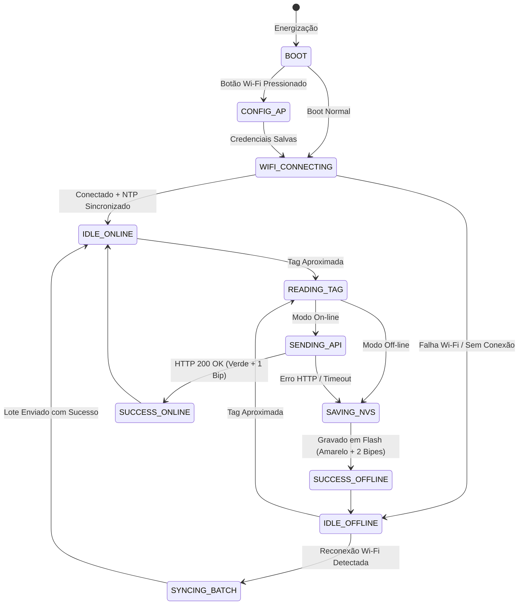

# SCP — Sistema de Chegada de Professores
> **Documentação do Projeto Multidisciplinar**
> **Disciplinas Envolvidas:** Sistemas Embarcados | Web II | Banco de Dados II

---

## Sumário
- [1. Visão Geral do Projeto](#1-visão-geral-do-projeto)
- [2. Fluxo de Funcionamento Detalhado](#2-fluxo-de-funcionamento-detalhado)
- [3. Especificação do Sistema Embarcado (IoT)](#3-especificação-do-sistema-embarcado-iot)
  - [3.1. Componentes e Hardware](#31-componentes-e-hardware)
  - [3.2. Mapeamento de Pinos e Conexões (Pinout)](#32-mapeamento-de-pinos-e-conexões-pinout)
  - [3.3. Arquitetura do Firmware & Concorrência (FreeRTOS & FSM)](#33-arquitetura-do-firmware--concorrência-freertos--fsm)
  - [3.4. Gestão de Memória Off-line e Persistência Local](#34-gestão-de-memória-off-line-e-persistência-local)
  - [3.5. Contrato de Comunicação & Payloads JSON (API REST)](#35-contrato-de-comunicação--payloads-json-api-rest)
  - [3.6. Provisionamento Wi-Fi & Sincronização NTP](#36-provisionamento-wi-fi--sincronização-ntp)
  - [3.7. Segurança, Autenticação & Atualização OTA](#37-segurança-autenticação--atualização-ota)
  - [3.8. Especificações do Gabinete Físico (Case 3D)](#38-especificações-do-gabinete-físico-case-3d)
  - [3.9. Requisitos Funcionais (RF-EMB)](#39-requisitos-funcionais-rf-emb---sistema-embarcado)
  - [3.10. Requisitos Não-Funcionais (RNF-EMB)](#310-requisitos-não-funcionais-rnf-emb---sistema-embarcado)
  - [3.11. Matriz de Testes do Sistema Embarcado](#311-matriz-de-testes-do-sistema-embarcado)
- [4. Arquitetura de Software e Persistência](#4-arquitetura-de-software-e-persistência)
  - [4.1. Backend (Go na Vercel)](#41-backend-go-na-vercel)
  - [4.2. Banco de Dados (PostgreSQL na Neon)](#42-banco-de-dados-postgresql-na-neon)
  - [4.3. Notificações (Telegram Bot API)](#43-notificações-telegram-bot-api)
- [5. Próximos Passos](#5-próximos-passos)

---

## 1. Visão Geral do Projeto

O projeto consiste em um **Sistema Inteligente de Registro de Presença e Localização de Professores em Tempo Real**.

A solução integra hardware (dispositivo IoT/Embarcado com **ESP32 DevKit v1** e **Leitor RFID I2C**) com um **Backend REST em Go** hospedado na **Vercel**, persistência em **PostgreSQL** na **Neon** e um **Bot do Telegram** para automatizar o registro de presença dos docentes nas salas de aula e laboratórios do campus, enviando avisos automáticos para os grupos das turmas no Telegram.

```
+--------------------+      Wi-Fi      +--------------------+     Bot API     +--------------------+
|  Leitor Embarcado  | --------------> |  Backend em Go     | --------------> |   Bot Telegram     |
| (ESP32 + RFID I2C) |                 |     (Vercel)       |                 | (Alertas / Turmas) |
+--------------------+                 +---------+----------+                 +--------------------+
                                                 |
                                                 v
                                       +--------------------+
                                       |  PostgreSQL (Neon) |
                                       +--------------------+
```

---

## 2. Fluxo de Funcionamento Detalhado

1. **Aproximação da Tag:** O professor aproxima sua tag de identificação (contendo apenas UID único) do leitor instalado na sala/laboratório.
2. **Leitura e Filtro (Debounce):** O firmware lê o UID da tag e aplica um filtro de tempo para ignorar leituras duplicadas acidentais.
3. **Determinação de Estado (Entrada vs. Saída):**
   - O sistema valida a leitura combinando a **alternância automática** (1º bip = Entrada, 2º bip = Saída) com o **cruzamento da grade horária do docente** no backend (Terça-feira, 19:00, Disciplina Y, Laboratório Z).
4. **Sinalização e Feedback:**
   - No dispositivo físico, o retorno ocorre via LED onboard do ESP32 e logs no Monitor Serial, além da confirmação imediata entregue pelo Bot do Telegram.
   - Na especificação visual do projeto, prevê-se também o uso do **Display OLED 1.3"** (exibindo relógio ao vivo, UID e confirmação `PONTO REGISTRADO!`) e sinalização via LEDs/Buzzer (simulados no Wokwi).
5. **Envio / Retransmissão de Dados:**
   - **Modo Conectado:** O embarcado envia os dados autenticados via HTTPS (`POST /api/v1/attendance`) para a API em Go na Vercel.
   - **Modo Off-line:** O registro com timestamp sincronizado via **NTP** é mantido em memória local e retransmitido quando a conexão restabelecer.
6. **Validação Inteligente e Disparo do Alerta:**
   - O backend valida no **PostgreSQL (Neon)** o professor, a sala e a janela de tempo entre o horário da leitura e o término da aula.
   - Estando dentro da janela da aula, dispara a notificação automática para o grupo da turma no **Telegram**; caso seja uma sincronização off-line atrasada após o término da aula, o alerta no Telegram é descartado, mantendo-se o registro histórico gravado no banco.

---

## 3. Especificação do Sistema Embarcado (IoT)

### 3.1. Componentes e Hardware

| Componente | Modelo Adotado | Função no Sistema |
| :--- | :--- | :--- |
| **Microcontrolador** | **ESP32 DevKit v1 (ESP-WROOM-32, 30 pinos)** | Unidade central de processamento (Dual-Core 240 MHz, Wi-Fi integrado, suporte a FreeRTOS). Gerencia o leitor RFID, relógio NTP e envio HTTP REST para a API na Vercel. |
| **Leitor RFID/NFC** | **Módulo RFID MFRC522 I2C (13.56 MHz, `0x28`)** | Leitura sem contato dos cartões/crachás dos professores via barramento I2C. |
| **Tags / Crachás** | **Cartões/Tags RFID 13.56 MHz (Mifare 1K / NTAG215)** | Identificação individual de cada docente através de UID único. |
| **Display OLED *(Especificação)*** | **Display OLED 1.3" I2C 128x64 (SH1106/SSD1306, `0x3C`)** | Interface visual prevista no projeto para exibir relógio ao vivo, status de conexão e confirmação de leitura (`PONTO REGISTRADO!`, UID e hora). *(Nota física: o painel de vidro do módulo apresentou queima durante testes em bancada, não integrando a montagem física final).* |
| **Fonte de Energia** | **Alimentação USB 5V estável (Cabo USB-C)** | Alimentação do ESP32 (`VIN` 5V) e do módulo RFID, prevenindo reinicializações por queda de tensão (*Brownout Reset*). |

---

### 3.2. Mapeamento de Pinos e Conexões (Pinout)

Ligação direta ponto a ponto no **ESP32 DevKit v1** (cabos Fêmea-Fêmea):

| Periférico | Pino no Componente | Pino no ESP32 DevKit v1 | Função / Protocolo |
| :--- | :--- | :--- | :--- |
| **RFID MFRC522 (I2C)** | `5V` | **`VIN`** *(topo direito)* | Alimentação 5V da USB |
| | `G` | **`GND`** *(topo direito)* | Terra |
| | `SDA` | **`GPIO 27` (`D27`)** | I2C Data (`Wire1` / endereço `0x28`) |
| | `SCL` | **`GPIO 26` (`D26`)** | I2C Clock (`Wire1` / endereço `0x28`) |
| **Display OLED 1.3" *(Especificação)*** | `VCC` / `GND` | `3V3` / `GND` *(topo esquerdo)* | Alimentação 3.3V |
| | `SDA` / `SCL` | `GPIO 21` (`D21`) / `GPIO 22` (`D22`) | I2C padrão (`Wire` / endereço `0x3C`) |

> *(Para a configuração de pinos usada na simulação virtual do Wokwi com LEDs, Buzzer e RFID SPI, consulte [`Wokwi_project/diagram.json`](./Wokwi_project/diagram.json)).*

---

### 3.3. Arquitetura do Firmware & Concorrência (FreeRTOS & FSM)

O firmware será desenvolvido em **C++ (Framework ESP-IDF / Arduino ESP32)** sobre o sistema operacional em tempo real **FreeRTOS**.

#### Mapeamento de Tasks FreeRTOS:
1. `Task_RFID_Scanner` (Core 0, Prioridade Alta): Varredura contínua do leitor RFID (100 ms) com filtro de debounce de 30 segundos.
2. `Task_Network_Manager` (Core 1, Prioridade Média): Gerenciamento da conexão Wi-Fi, envio HTTP REST e sincronização da fila off-line.
3. `Task_UI_Feedback` (Core 1, Prioridade Baixa): Processamento da fila de comandos para o LED RGB e Buzzer sem bloquear a leitura.
4. `Task_Telemetry` (Core 1, Prioridade Baixa): Disparo periódico de Heartbeat (a cada 5 minutos).

#### Diagrama da Máquina de Estados Finos (FSM):



---

### 3.4. Gestão de Memória Off-line e Persistência Local

Em caso de queda da rede Wi-Fi, os eventos de presença são mantidos em memória não-volátil interna (**LittleFS** na Flash do ESP32).

#### Estrutura do Registro Binário (`struct` C++):
```cpp
struct AttendanceRecord {
    char tag_uid[12];      // UID do cartão (ex: "A1B2C3D4") - 12 bytes
    uint64_t timestamp;    // Timestamp UNIX UTC em segundos - 8 bytes
    uint8_t status_flags;  // Bitmask (0x01: Pendente, 0x02: Validado) - 1 byte
    uint16_t crc16;        // Checksum CRC16 de integridade - 2 bytes
}; // Tamanho total por registro: ~23 bytes
```

- **Capacidade Recomendada:** Partição de 1 MB dedicada ao LittleFS armazena com segurança mais de **40.000 leituras off-line**. O requisito mínimo do projeto é armazenar 500 leituras (consumindo apenas ~11.5 KB).
- **Garantia contra Queda de Energia:** Cada registro possui checksum CRC16. Ao religar o dispositivo, registros corrompidos são ignorados automaticamente.
- **Política de Fila Cheia:** Estrutura FIFO (First-In, First-Out). Se a memória atingir 100% da capacidade limite configurada, a leitura mais antiga é descartada para dar lugar à nova leitura, registrando um aviso de alerta na telemetria.

---

### 3.5. Contrato de Comunicação & Payloads JSON (API REST)

A comunicação entre o Embarcado e o Backend ocorrerá via **HTTP REST** (Porta 443 HTTPS com criptografia TLS 1.2).

#### 1. Envio de Presença On-line (`POST /api/v1/attendance`)
```json
{
  "device_id": "EMB-LAB-101",
  "tag_uid": "4A8B12F0",
  "read_timestamp": 1727187600,
  "rssi": -65,
  "is_offline_record": false
}
```

#### 2. Sincronização Off-line em Lote (`POST /api/v1/attendance/sync-batch`)
```json
{
  "device_id": "EMB-LAB-101",
  "batch_count": 2,
  "records": [
    {
      "tag_uid": "4A8B12F0",
      "read_timestamp": 1727180400
    },
    {
      "tag_uid": "9C3D45E6",
      "read_timestamp": 1727184000
    }
  ]
}
```

#### 3. Telemetria e Heartbeat (`POST /api/v1/telemetry/heartbeat`)
```json
{
  "device_id": "EMB-LAB-101",
  "firmware_version": "1.2.0",
  "uptime_seconds": 86400,
  "wifi_rssi": -62,
  "free_heap_bytes": 184520,
  "offline_pending_count": 0
}
```

---

### 3.6. Provisionamento Wi-Fi & Sincronização NTP

1. **Portal Cativo para Configuração de Wi-Fi (WiFiManager):**
   - Caso o leitor não consiga se conectar a nenhuma rede Wi-Fi conhecida, o ESP32 entra no modo **Access Point** criando uma rede de configuração para selecionar o SSID local e digitar a senha.
2. **Sincronização de Data/Hora (NTP):**
   - Ao conectar à internet, o ESP32 consulta o servidor NTP (`pool.ntp.org`) e mantém o relógio interno atualizado (GMT-3) para registro dos timestamps de leitura.

---

### 3.7. Segurança, Autenticação & Atualização OTA

- **Autenticação por Dispositivo:** Cada leitor possui um token secreto único (`X-Device-Token`) gravado na partição protegida NVS do ESP32, enviado nos cabeçalhos das requisições HTTP.
- **Proteção dos Dados:** Criptografia TLS 1.2 (HTTPS) em todo o tráfego de dados. As senhas de Wi-Fi salvas no ESP32 são protegidas pela **Flash Encryption** nativa da linha ESP32.
- **Atualizações Over-The-Air (OTA):** O firmware suporta atualização remota via Wi-Fi (`HTTP OTA Update`). A memória Flash do ESP32 possui duas partições de aplicação (`OTA_0` e `OTA_1`). Caso o novo firmware apresente crash no boot, o ESP32 executa o **Rollback** automático para a versão anterior.

---

### 3.8. Especificações do Gabinete Físico (Case 3D)

- **Material de Fabricação:** Impressão 3D em **PETG ou ABS** (maior resistência térmica e mecânica para ambientes escolares/universitários).
- **Design Ergonomico:**
  - Suporte traseiro para fixação rápida com parafusos ou fita dupla face 3M VHB na entrada das salas/laboratórios.
  - Recuo frontal com adesivo instrucional (*"Aproxime seu Cartão Aqui"*).
  - Janela superior de difusão de luz em acrílico translúcido para o **LED RGB Neopixel**.
  - Aberturas acústicas inferiores para propagação clara do som do **Buzzer**.
  - Conector de entrada MicroUSB/USB-C posicionado na parte inferior para evitar infiltração de poeira.

---

### 3.9. Requisitos Funcionais (RF-EMB) — Sistema Embarcado

| Código | Nome | Descrição |
| :--- | :--- | :--- |
| **RF-EMB-01** | Leitura de Tag | O sistema embarcado deve realizar a leitura do identificador único (UID) da tag por aproximação. |
| **RF-EMB-02** | Filtro Anti-Duplicação (*Debounce*) | O firmware deve ignorar leituras consecutivas da mesma tag dentro de um intervalo parametrizável de tempo (ex: 30 segundos). |
| **RF-EMB-03** | Sinalização Visual via LED RGB | O firmware deve acionar o LED RGB indicando o estado atual da operação (Verde: Sucesso/On-line; Amarelo: Off-line; Vermelho: Erro; Azul: Conectando Wi-Fi). |
| **RF-EMB-04** | Sinalização Sonora via Buzzer | O firmware deve emitir padrões sonoros distintos (1 bipe curto: Sucesso; 2 bipes curtos: Off-line; 1 bipe longo: Erro de leitura/conexão). |
| **RF-EMB-05** | Envio de Eventos de Presença | O sistema deve transmitir para o Backend o `UID` da tag, o `Token/ID` do dispositivo e a `data/hora` da leitura. |
| **RF-EMB-06** | Sincronização NTP | O sistema embarcado deve sincronizar seu relógio interno via servidor NTP (`pool.ntp.org`) sempre que houver conexão com a internet. |
| **RF-EMB-07** | Armazenamento Off-line | Em caso de ausência de rede Wi-Fi, o leitor deve salvar a leitura com timestamp local na memória não-volátil interna (LittleFS). |
| **RF-EMB-08** | Retransmissão pós-Reconexão | Ao restabelecer a conexão Wi-Fi, o leitor deve retransmitir automaticamente os registros salvos em memória para o backend na ordem cronológica. |
| **RF-EMB-09** | Envio de Telemetria (*Heartbeat*) | O leitor deve enviar pings de status a cada N minutos informando que está ativo (*Online, Nível de Sinal Wi-Fi RSSI, Uptime, Heap Livre*). |
| **RF-EMB-10** | Portal Cativo Wi-Fi | O dispositivo deve permitir a configuração fácil de credenciais Wi-Fi via modo Access Point caso a rede caia ou o botão de reset seja pressionado. |

---

### 3.10. Requisitos Não-Funcionais (RNF-EMB) — Sistema Embarcado

| Código | Nome | Descrição |
| :--- | :--- | :--- |
| **RNF-EMB-01** | Tempo de Resposta Local | O feedback visual e sonoro (LED e Buzzer) deve ocorrer em menos de 300 ms após a aproximação da tag. |
| **RNF-EMB-02** | Privacidade de Dados no Hardware | O embarcado não deve armazenar nem trafegar informações pessoais do professor; apenas o UID serial do cartão RFID. |
| **RNF-EMB-03** | Comunicação Criptografada | As requisições enviadas ao backend devem ser criptografadas via HTTPS (TLS 1.2). |
| **RNF-EMB-04** | Capacidade da Memória Off-line | A memória não-volátil deve ser capaz de armazenar no mínimo 500 eventos de leitura em modo desconectado sem perda de dados. |
| **RNF-EMB-05** | Compatibilidade de Rede Wi-Fi | O módulo de rede deve suportar o padrão Wi-Fi 802.11 b/g/n (2.4 GHz). |
| **RNF-EMB-06** | Recuperação pós-Queda de Energia | O sistema deve reiniciar e estar pronto para uso em no máximo 15 segundos após receber energia. |
| **RNF-EMB-07** | Autenticação por Dispositivo | Cada leitor deve possuir um token de autenticação único gravado em firmware para garantir a origem dos dados na API. |

---

### 3.11. Matriz de Testes do Sistema Embarcado

| ID | Cenário de Teste | Procedimento | Resultado Esperado |
| :--- | :--- | :--- | :--- |
| **TST-EMB-01** | Leitura Normal On-line | Aproximar tag cadastrada com Wi-Fi conectado. | LED pisca Verde + 1 bipe curto. Registro gravado no backend. |
| **TST-EMB-02** | Filtro de Debounce | Aproximar a mesma tag 3 vezes em menos de 5 segundos. | Apenas a 1ª leitura é processada. As 2 leituras seguintes são ignoradas. |
| **TST-EMB-03** | Transição para Off-line | Desligar o roteador Wi-Fi e aproximar a tag. | LED pisca Amarelo + 2 bipes curtos. Evento gravado na Flash LittleFS. |
| **TST-EMB-04** | Sincronização pós-Reconexão| Religar o Wi-Fi após acumular 5 leituras off-line. | O leitor reconecta e envia os 5 registros em lote para o backend. |
| **TST-EMB-05** | Reconexão e Sincronização de Horário | Desligar a energia e religar com conexão Wi-Fi ativa. | O ESP32 reconecta automaticamente e sincroniza a hora exata via NTP. |

---

## 4. Arquitetura de Software e Persistência

### 4.1. Backend (Go na Vercel)
* **Linguagem & Runtime:** **Go** executado como *Serverless Functions* na plataforma **Vercel**.
* **Responsabilidades:**
  * Receber os eventos de leitura enviados pelo ESP32 via API REST/HTTPS (`/api/v1/attendance`, `/api/v1/attendance/sync-batch`, `/api/v1/telemetry/heartbeat`) validando o cabeçalho de autenticação `X-Device-Token`.
  * Consultar e persistir dados no banco **PostgreSQL (Neon)**.
  * Cruzar o `tag_uid` do professor e o `device_id` da sala com a grade horária para determinar Entrada/Saída e validar a janela da aula.
  * Acionar a **API do Telegram** para notificar os grupos das turmas.

### 4.2. Banco de Dados (PostgreSQL na Neon)
* **Banco de Dados Único:** **PostgreSQL** gerenciado na nuvem pela **Neon** (compatível com execução *serverless* na Vercel).
* **Dados Armazenados:** Cadastros de professores e tags UID, salas/blocos e dispositivos ESP32, turmas, disciplinas, grades horárias, histórico de presenças (entradas/saídas) e logs de telemetria/eventos.

### 4.3. Notificações (Telegram Bot API)
* **Integração:** Chamada HTTP direta do backend em Go para a **Telegram Bot API** (`sendMessage`), enviando automaticamente os avisos de chegada/saída dos professores nos grupos das respectivas turmas.

---

## 5. Próximos Passos

- [x] Definir arquitetura completa: **ESP32 DevKit v1 + RFID I2C** → **Go (Vercel)** → **PostgreSQL (Neon)** + **Bot Telegram**.
- [x] Validar fisicamente o hardware (**ESP32 DevKit v1** + **Leitor RFID MFRC522 I2C**).
- [ ] Limpar arquivos temporários do repositório e atualizar o firmware final do ESP32 com conexão Wi-Fi e envio HTTP para a API.
- [ ] Modelar as tabelas no **PostgreSQL (Neon)** e implementar os endpoints em **Go** na **Vercel** integrados ao **Bot do Telegram**.
